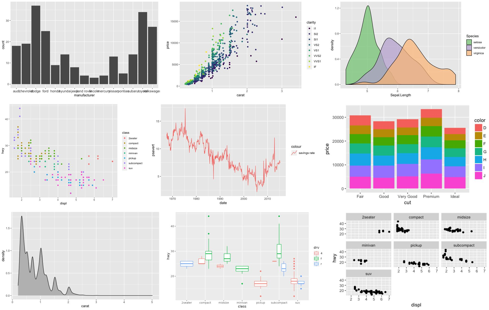

## From Learning R to Building and Publishing My Data Portfolio

My journey into statistics, programming, data analysis, and data science has always been driven by one central goal: **to move beyond merely understanding statistical concepts and become capable of applying them confidently using modern analytical tools**.

As part of that journey, I undertook an intensive programming and data-analysis training programme with **GBG Analytics**, running from **21 July to 7 October 2026**.

The training used a **lab-based approach**, with emphasis on practical learning, hands-on exercises, demonstrations, assignments, independent practice, and supporting video materials. This approach meant that the programme was not simply about watching someone write code or memorising R functions. I was required to write the code myself, work with datasets, make mistakes, troubleshoot errors, create visualisations, document my analysis, and gradually develop complete analytical projects.

That practical method made R considerably easier for me.

{fig-align="center"}

Before the training, R sometimes appeared to be a collection of unfamiliar functions, symbols, packages, brackets, and error messages. As the training progressed, however, I began to understand the logic behind the language and, more importantly, how the different components of the data-analysis process connect.

The programme covered **Introduction to R Programming, data manipulation and cleaning, data visualisation with ggplot2 and Base R, data merging and joining, Markdown and reproducible reporting, Quarto publishing, and Git/GitHub**.

What made the programme especially valuable was that these topics were not treated as isolated subjects. They gradually came together to form a complete workflow—from raw data to a finished analytical product published on the web.

## Introduction to R Programming

The training began with the fundamentals of **R programming**.

This stage helped me understand how R stores and processes information and how analytical operations are built from relatively simple components.

I learnt how to create objects and assign values using expressions such as:

```{r}
x <- 10
```

We explored major R data types, including numeric, integer, character, logical and factor variables, as well as important data structures such as vectors, matrices, lists, factors and data frames.

For example:

```{r}
age <- c(25, 31, 28, 40, 36)
```

creates a numeric vector containing five observations.

I became familiar with fundamental functions such as `mean()` for arithmetic means, `median()` for the middle value, `sum()` for totals, `min()` and `max()` for extreme values, and `sd()` for standard deviation.

Functions such as `summary()`, `str()`, `head()`, `tail()`, `table()`, `unique()`, `length()` and `is.na()` became important tools for understanding and checking datasets.

The training helped me appreciate an important principle: **before analysing data, the analyst must first understand the data**.

Knowing how R represents numeric, categorical, logical, and missing information is fundamental because the structure and type of a variable determine which analytical techniques are appropriate.

## Data Manipulation and Cleaning

The next important area was **data manipulation and data cleaning**.

Real-world data rarely arrive in a perfectly organised state. Data may contain missing observations, poorly labelled variables, duplicates, inconsistent categories, unnecessary columns, incorrect data types, or information that needs to be transformed before meaningful analysis can begin.

I therefore learnt to use the `dplyr` package extensively.

Functions such as `select()` allow an analyst to choose particular variables, while `filter()` makes it possible to retain observations satisfying specific conditions.

For example:

```{r}
# data |>
#  filter(age >= 18)
```

can retain observations where age is at least 18.

I learnt to use `arrange()` for sorting data, `mutate()` for creating new variables, `rename()` for changing variable names, `distinct()` for dealing with unique records, and `count()` for obtaining category frequencies.

The combination of `group_by()` and `summarise()` was particularly useful because it allowed me to calculate statistics separately for meaningful groups.

For example:

`data |>   group_by(gender) |>   summarise(     mean_income = mean(income, na.rm = TRUE)   )` This kind of workflow can answer questions such as:

> What is average income by gender?

> What is total revenue by region?

> How many observations belong to each category?

> What is the average score across departments?

I also became more comfortable with R's pipe operator:

The Native Pipe `|>` or The Magrittr Pipe `%>%`

which makes a sequence of analytical operations easier to read.

Gradually, my understanding of analysis developed into a workflow:

**Import → Inspect → Clean → Transform → Group → Summarise → Analyse → Visualise → Communicate.**

## Data Visualisation Using ggplot2

One of the most enjoyable parts of the programme was **data visualisation**.

I learnt that visualisation is much more than making a report colourful. A good graph should have a purpose. It should reveal a trend, highlight a difference, expose a relationship, show a distribution, or make a statistical message easier to understand.

{fig-align="center"}

One of the major packages explored was **`ggplot2`**.

With `ggplot2`, I learnt the concept of constructing visualisations through layers.

A typical graph may begin with:

```         
ggplot(data, aes(x = age, y = income))
```

and then have a geometry added:

```         
geom_point()
```

The `aes()` function defines how variables are mapped to visual properties such as the x-axis, y-axis, colour, fill, size, or shape.

Different `geom_*()` functions allow the analyst to create different kinds of graphs.

`geom_point()` is useful for scatterplots.

`geom_bar()` displays counts of categorical observations.

`geom_col()` is useful when bar heights have already been calculated.

`geom_line()` is particularly valuable when examining trends across time or another ordered variable.

`geom_histogram()` helps reveal the distribution of continuous data.

`geom_boxplot()` provides information about distributions, median values, spread, and potential outliers.

`geom_smooth()` can be used to display a fitted relationship between variables.

I also learnt about `facet_wrap()` and `facet_grid()` for creating separate panels for different groups.

Functions such as `labs()` make it possible to add meaningful titles, subtitles, axis labels, and captions, while themes such as `theme_minimal()`, `theme_classic()` and `theme_bw()` help control the appearance of the final visualisation.

The broader concepts of **aesthetics, geometry, scales, layers, coordinates, themes, legends, and faceting** became much clearer to me during the training.

## Data Visualisation Using Base R

Alongside `ggplot2`, I was also introduced to **Base R graphics**.

This provided another perspective on visualisation and demonstrated that R contains built-in graphical capabilities even without additional packages.

Some important functions included:

```         
plot() hist() barplot() boxplot() pie()
```

For example:

```         
hist(data$income)
```

can quickly display the distribution of income.

Similarly:

```         
boxplot(data$income)
```

can provide information about the median, variability, and possible outliers.

Working with both Base R and `ggplot2` helped me appreciate their different strengths.

Base R can be excellent for rapid exploratory work, while `ggplot2` offers a more structured, layered, and highly customisable approach to creating publication-quality visualisations.

## Data Merging and Joining

Another important component of the training was **merging and joining datasets**.

In real analytical work, information is frequently spread across multiple files.

One table might contain demographic information while another contains transactions. A third might contain geographical information.

To analyse them together, they must be joined correctly.

I learnt functions including:

```         
left_join() right_join() inner_join() full_join()
```

A `left_join()` retains all observations from the first dataset and adds matching information from the second.

An `inner_join()` keeps only observations whose keys exist in both datasets.

A `full_join()` retains observations from both sides whether or not a match exists.

The training also highlighted the importance of understanding **keys, identifiers, duplicates and matching variables**.

This was an important lesson because a badly executed join can silently multiply observations and produce perfectly calculated statistics from completely incorrect data. Data analysis has a mischievous sense of humour that way.

## Markdown and Reproducible Reporting

The training introduced me to **Markdown**, which later became very important for working with reproducible reports.

Markdown provides a simple syntax for structuring written content.

For example:

```         
# Main Heading  ## Subheading  **Bold text**  *Italic text*
```

This allowed me to understand how analytical writing could be structured without depending entirely on traditional word-processing software.

From Markdown, the programme progressed into the wider concept of **reproducible reporting**.

This became one of the most important parts of the training for me.

In a conventional workflow, an analyst may analyse data in R, save graphs manually, copy tables into Word, type statistical values into paragraphs, and then have to repeat those processes whenever the underlying data change.

That creates several opportunities for inconsistency.

A graph may be updated while the accompanying paragraph still reports an old figure. A table may contain a newly calculated value while the executive summary contains yesterday's number.

Reproducible reporting provides a better approach by connecting the **data, analytical code, results, graphs, tables, interpretation, and final document**.

## Quarto: From R Analysis to Professional Publishing

**Quarto was one of the most important and transformative topics I encountered during the programme.**

{fig-align="center"}

Initially, I understood Quarto mainly as a way of producing reports. As the training progressed, however, I discovered that its capabilities extend far beyond traditional reporting.

Quarto provides an environment in which an analyst can combine **R code, explanatory writing, statistical results, tables, visualisations, equations, citations, references, and conclusions within a single reproducible project**.

A standard Quarto document normally uses the `.qmd` extension.

For example:

```         
analysis.qmd
```

A Quarto document can contain three major building blocks:

**YAML**, which controls the document;

**Markdown**, which contains the written explanation;

and **R code chunks**, which perform the actual calculations and generate output.

A simple Quarto document can therefore contain something like:

```         
--- title: "Statistical Analysis" author: "Aare" format: html ---  # Introduction  This report presents an analysis conducted in R.  ```{r} summary(mtcars) ```
```

When the document is rendered, the R code is executed and the results are inserted automatically into the finished publication.

This was a major shift in the way I thought about reporting.

Instead of:

**Analyse → Copy → Paste → Edit → Repeat**

Quarto makes a workflow such as this possible:

**Data → R Code → Statistical Analysis → Graphs and Tables → Interpretation → Render → Finished Publication**

Another useful concept was controlling what the reader sees.

For example:

```         
#| echo: false
```

allows the R code to execute without displaying the code itself in the final publication.

This is useful when preparing analytical reports for readers who need the findings but do not necessarily need to see every line of programming behind them.

### Publishing to Different Formats

Another major strength of Quarto is that a single source project can be published in several forms.

I learnt how Quarto can support outputs such as **HTML reports, Microsoft Word documents, PDF reports, presentations, books, technical documentation, blogs, and complete websites**.

This made me understand Quarto not simply as a document-writing tool but as a genuine **publishing system for data professionals**.

The same analytical work can therefore move from an R environment into something suitable for colleagues, researchers, managers, students, clients, or the general public.

## Creating and Publishing Websites with Quarto

Perhaps one of the most exciting discoveries was learning that **Quarto can be used to create and publish a complete website**.

This considerably expanded my understanding of what an analyst can achieve with R-related tools.

A Quarto website can contain several interconnected pages such as:

**Home, About, Projects, Portfolio, Research, Publications, Blog, Resources, and Contact pages.**

Each page can be written as a `.qmd` document.

A project-level file named:

```         
_quarto.yml
```

can then control the overall structure of the website.

This file can define the website title, navigation menu, themes, page structure, links, search functionality and other publishing settings.

A typical project could therefore look like:

```         
portfolio/ │ ├── _quarto.yml ├── index.qmd ├── about.qmd ├── projects.qmd └── contact.qmd
```

Quarto then connects those individual files into a complete website.

This was especially meaningful because the training did not end at theoretical knowledge.

**I applied what I learnt by creating my own data portfolio website:**

### adept-data.github.io

Building my portfolio represented an important milestone in the programme.

It gave me an online platform where I can continue to showcase my development in **R programming, statistics, data analysis, data visualisation, reproducible reporting, Quarto, and other areas of data science**.

The experience showed me how several apparently separate skills can combine into one complete project.

The R projects provide the analytical substance.

Markdown provides the written content.

Quarto provides the website structure and publishing system.

Git tracks the development history.

GitHub stores the repository.

GitHub Pages makes the resulting website available online.

The complete journey can therefore be represented as:

> **Learn R → Analyse Data → Create Visualisations → Document the Analysis → Build with Quarto → Track with Git → Publish through GitHub → Share a Professional Portfolio**

That was one of the most significant practical outcomes of the training.

**I did not merely learn that Quarto can build websites. I built and published one myself.**

For a data analyst, this is particularly valuable because the portfolio becomes more than a résumé. It becomes living evidence of practical ability.

## Git and GitHub

The programme also introduced me to **Git and GitHub**, which completed another important part of the modern data-science workflow.

{fig-align="center"}

Git is a **version-control system** that allows changes to project files to be tracked over time.

This provides a much better alternative to keeping multiple confusing copies of the same analysis with filenames such as:

```         
analysis_final.R analysis_final2.R analysis_final_corrected.R analysis_final_corrected_latest.R analysis_REAL_FINAL.R
```

Git allows project development to be recorded systematically.

I became familiar with commands and concepts such as:

```         
git init git status git add git commit git push git pull git clone
```

I also learnt about repositories, commits, branches, remote repositories, merging, and project history.

GitHub complements Git by providing an online platform where repositories can be stored, shared, reviewed, collaborated on, and published.

For me, its importance became even more obvious when it was connected to my **Quarto portfolio website**.

Git and GitHub therefore became more than tools for storing code.

They became part of a workflow for **documenting, managing and publishing my professional work**.

## A Training Built Around Practice

An important strength of my experience with **GBG Analytics** was the lab-based nature of the programme.

The training involved practical demonstrations, hands-on exercises, assignments, coding practice, troubleshooting, independent experimentation, and video resources that I could revisit whenever necessary.

This reinforced an important truth about programming:

**you cannot become comfortable with code merely by watching somebody else write it.**

You have to write it.

You have to break it.

You have to wonder why an error message has suddenly developed a personal grudge against you.

Then you have to investigate, correct the mistake, and try again.

That process gradually builds confidence.

The supporting videos were particularly valuable because they made it possible to revisit difficult areas, repeat demonstrations, and practise concepts at my own pace.

## What the Training Changed for Me

The greatest benefit of the programme was not simply learning more R functions.

It changed the way I understand the **entire analytical process**.

I now see data analysis as a connected sequence:

**Define the question → Import the data → Inspect → Clean → Transform → Merge → Analyse → Visualise → Interpret → Document → Reproduce → Version-control → Publish → Communicate.**

That wider perspective is important.

A data analyst is not simply someone who knows how to calculate a mean or run a model.

A strong analyst must understand the underlying data, select appropriate analytical methods, write understandable code, design meaningful visualisations, explain findings clearly, make the work reproducible, preserve its history, and communicate the final product to other people.

## My Experience with GBG Analytics

My training with **GBG Analytics from 21 July to 7 October 2026** represented an important stage in my development as a statistician, programmer and data professional.

R became considerably easier for me.

Data manipulation became more systematic.

Data cleaning became more intentional.

Visualisation became more meaningful.

Markdown gave structure to analytical writing.

Reproducibility changed how I think about reporting.

Git and GitHub introduced disciplined project management and publishing.

And Quarto showed me how analytical work can move beyond an R session and become a professional report, presentation, publication, or complete website.

Most importantly, these skills produced something tangible.

### I created and published my own portfolio at **adept-data.github.io**.

That transition—from learning R code to publishing my own analytical portfolio—is one of the strongest outcomes of the programme for me.

## Recommendation

For anyone seeking practical training in **R programming, statistics, data analysis, data cleaning, `dplyr`, data visualisation, Base R graphics, `ggplot2`, data merging, Markdown, reproducible reporting, Quarto, Git, GitHub, portfolio development, and modern data-science workflows**, I would encourage you to consider **GBG Analytics**.

Data science can initially look like a collection of disconnected tools.

R is here.

Statistics is there.

Git sits somewhere else.

Quarto appears from another corner.

Then someone mentions GitHub, packages, Markdown, joins, YAML, rendering, repositories and websites, and suddenly the learning journey begins to resemble a family meeting where everybody is talking at once.

Good training helps connect those pieces.

That was one of the most valuable things this programme did for me.

The training did not simply make R easier.

It helped me see how **programming, statistics, visualisation, reproducibility, version control, and publishing belong to the same professional workflow**.

From writing R code to creating graphs, from manipulating datasets to writing reproducible reports, and from learning Quarto to publishing my own portfolio website, the journey has been practical, challenging, and worthwhile.

**Thank you, GBG Analytics, for making the learning process practical and meaningful.**

### From learning R to publishing my own data portfolio—the journey continues.

For my full Portfolio click [here](https://adept-data.github.io/)
