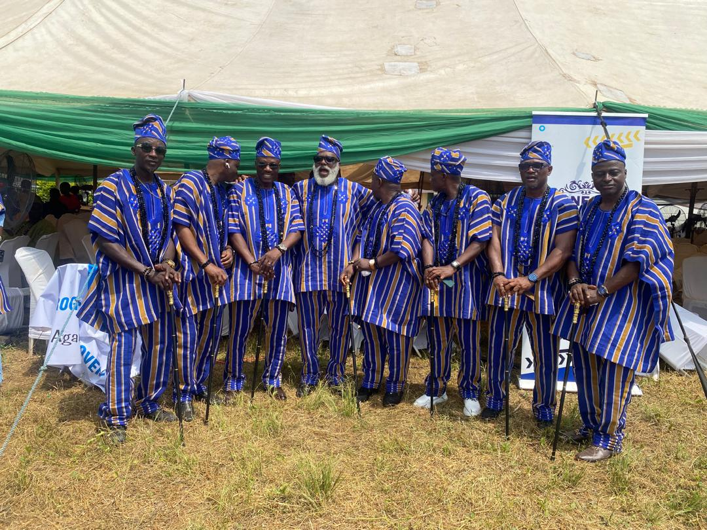
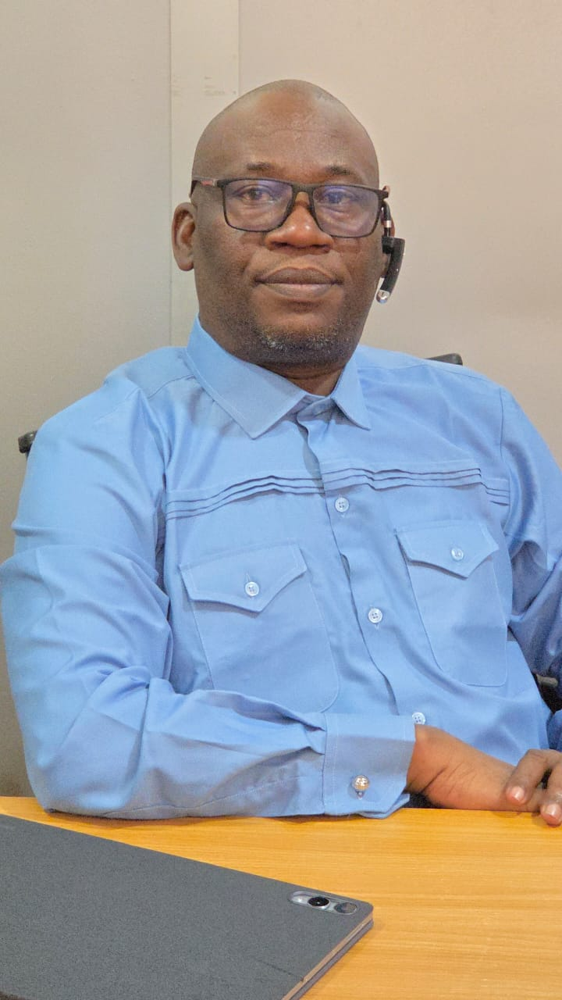

# MY JOURNEY INTO THE IROLU PROGRESSIVE MOVEMENT (IPM): A HOMECOMING, A SENSE OF BELONGING, AND A COMMITMENT TO COMMUNITY DEVELOPMENT

Saturday, 17th October 2026, marked a significant and memorable milestone in my personal journey, as I had the rare privilege of becoming a member of the **Irolu Progressive Movement (IPM)**, a respected association of progressive minds united by a shared commitment to the growth, development, and advancement of Irolu, my beloved maternal ancestral home.

For me, this was more than joining another social or community association. It was a conscious return to my roots, an opportunity to strengthen my ancestral connections, and, more importantly, a personal declaration of my willingness to contribute to the progress of a community whose history and heritage form an inseparable part of my identity.

{fig-align="left"}

Interestingly, my admission into this distinguished movement coincided with **Agan-un Day**, a culturally significant occasion when the good people of Irolu come together in celebration of their heritage, traditions, unity, and enduring communal spirit. There could hardly have been a more symbolic occasion for me to identify formally with a movement devoted to the prosperity of the town. While the community celebrated its cultural identity, I found myself embracing a renewed responsibility towards the land of my forebears.

### The Inspiration Behind My Membership

My journey into the Irolu Progressive Movement was greatly influenced by my beloved aunt, **Chief (Mrs.) Abioye Olusola, fondly and respectfully known as Yeye**, whose wisdom, encouragement, and sense of communal responsibility have remained admirable to me.

Recognising the importance of my ancestral connection to Irolu, Yeye believed it was necessary for me to identify with individuals who are genuinely passionate about the development of our hometown. She saw beyond mere membership; she recognised an opportunity for me to associate with purposeful minds, contribute my professional knowledge and experience, and become actively involved in efforts aimed at advancing the collective interests of Irolu.

Following our discussion, she recommended that I join the Irolu Progressive Movement, an association she considered worthy of my participation, commitment, and service.

I received her recommendation with an open mind and a strong sense of responsibility. Having reflected on the values and objectives of the movement, I gladly embraced the opportunity.

I remain profoundly grateful to Yeye, not only for facilitating my introduction to this noble association but also for reminding me, through her thoughtful intervention, that our connection to our ancestral homes should extend beyond occasional visits, cultural identification, and expressions of pride. Such connections must equally translate into meaningful participation, collective responsibility, and tangible contributions to community development.

### A Warm Reception and the Formalisation of My Membership

My first experience with the Irolu Progressive Movement was particularly encouraging, largely because of the remarkable warmth and openness with which I was received.

I wish to specially acknowledge **Mr. Sunkanmi Ajẹmọlẹ and Mr. Abimbola Sobade**, whose reception, guidance, and welcoming disposition made my introduction to the movement both seamless and memorable.

Their willingness to accommodate me, provide the necessary information, and facilitate my integration into the association reflected the spirit of fellowship and mutual respect that I believe should characterise any progressive organisation.

I was particularly impressed by the cordiality of their engagement and the ease with which they made me feel accepted. Such gestures, however simple they may appear, speak volumes about the culture of an organisation and the character of the individuals who sustain it.

In keeping with the established procedures of the association, I subsequently fulfilled **all stipulated membership obligations on Monday, 19th October 2026**, thereby completing the necessary formalities associated with my admission.

On that same Monday, I formally introduced myself to members of the movement, expressing my appreciation for the privilege of joining their ranks and outlining my ancestral background, professional identity, and motivation for becoming part of the association.

### My Identity, Ancestral Heritage, and Professional Background

In my introductory message, I proudly presented myself as **Yusuf Akíntúndé Azeez**, a grandson of the **Pa Awomosu family, popularly known as Baba Ibadan, of Itun Oloja Quarters, Irolu**.

I am equally a descendant of the **Agbelesebiogun and Fagbohun families of Itun Lusi**, ancestral lineages whose historical connections to the town continue to strengthen my sense of identity, belonging, and responsibility.

These family ties are more than genealogical references to me. They represent a living heritage, a reminder of the generations before us, and an enduring obligation to preserve the dignity, unity, and prosperity of the community from which we draw our ancestral identity.

Professionally, I am a **Statistician and Data Analyst**, currently serving as a **Violation Monitoring Officer with the National Agency for Food and Drug Administration and Control (NAFDAC)**.

My professional experience has reinforced my belief in accountability, informed decision-making, structured planning, and the importance of measurable outcomes in achieving sustainable development.

I believe these principles are equally relevant to community advancement. Beyond passion and good intentions, meaningful development requires credible information, thoughtful planning, strategic collaboration, and the discipline to translate collective aspirations into practical results.

It is therefore my sincere hope that, in whatever capacity the movement may consider appropriate, I will have opportunities to contribute my knowledge, analytical experience, ideas, and resources towards initiatives that will positively influence the development of Irolu.

### Beyond Membership: A Commitment to a Greater Cause

My decision to join the Irolu Progressive Movement was not informed by the desire to merely add another association to my affiliations. Rather, it arose from a deeply held conviction that **the advancement of our communities must remain a collective responsibility, particularly among those privileged to possess the knowledge, exposure, experience, and capacity to make a difference.**

I strongly believe that a community grows when its people deliberately come together, rise above personal differences, identify shared challenges, and pursue solutions with sincerity and consistency.

No town becomes prosperous by wishes alone. Development is the outcome of deliberate choices, purposeful leadership, collective sacrifice, and the sustained efforts of individuals who believe that the future of their community is worth investing in.

Irolu is blessed with history, culture, human capital, and considerable potential. Harnessing these advantages requires unity of purpose, continuity of vision, and an unwavering commitment to community interests above personal considerations.

From what I have come to understand about the Irolu Progressive Movement, I acknowledge and appreciate the association's pedigree, resilience, and determination to contribute towards making Irolu a community of greater prominence and recognition within **Remo land and Ogun State at large**.

I regard this commitment as both commendable and worthy of support.

As a new member, I do not pretend to possess all the answers to the challenges confronting our hometown. I am, however, willing to learn from those who have invested their time, energy, and resources in the progress of the community long before my arrival.

I am equally prepared to offer my modest contributions, participate constructively in discussions, respect established structures, and support initiatives that advance the collective good.

### My Appreciation and Expectations

I extend my heartfelt appreciation to the leadership and entire membership of the Irolu Progressive Movement for the opportunity to become part of this noble association.

I remain especially grateful to my aunt, Chief (Mrs.) Abioye Olusola (Yeye), for recognising the value of this association and encouraging me to become involved. Her recommendation was the bridge through which I found my way into this community of progressive minds, and I deeply appreciate her confidence in me.

My sincere gratitude also goes to Mr. Sunkanmi Ajẹmọlẹ and Mr. Abimbola Sobade for their exceptional reception and assistance throughout my introduction and membership process.

To every distinguished member of IPM, I recognise the wealth of knowledge, experience, sacrifice, and dedication that each person brings to the association. I look forward to building meaningful relationships, learning from your experiences, and working harmoniously towards our shared aspirations.

I also look forward to receiving further guidance on the movement's programmes, expectations, responsibilities, and areas where my participation may be most beneficial.

### A Personal Reflection and Pledge

As I reflect on my admission into the Irolu Progressive Movement on 17th October 2026, I am reminded that belonging to a community is both a privilege and a responsibility.

Our ancestors handed down to us a heritage built over generations. Our obligation is not merely to celebrate their names or remember their contributions, but to ensure that the communities they helped establish continue to flourish under our watch.

**We must strive to leave Irolu better than we met it, stronger than we inherited it, and more prosperous for generations yet unborn.**

For me, joining IPM represents a modest but deliberate step in that direction.

{fig-align="center"}

I come with humility, a willingness to learn, an open mind, and a genuine desire to serve. I believe strongly in the power of progressive thinking, constructive engagement, and collective action. I also believe that when individuals of goodwill unite around a common purpose, even the most ambitious aspirations can gradually become achievable realities.

As I begin this new chapter, my prayer and sincere expectation are that the Irolu Progressive Movement will continue to wax stronger, deepen its relevance, and remain a formidable force for unity, community advancement, and sustainable development.

May our deliberations inspire meaningful action, may our efforts produce enduring results, and may the generations coming after us find sufficient reasons to appreciate the contributions we make today.

Above all, may history remember us not merely as people who spoke passionately about the progress of Irolu, but as individuals who made deliberate and measurable contributions towards its actualisation.

**I am proud of my roots. I am proud to identify with Irolu. And I am honoured to begin this journey with the Irolu Progressive Movement.**

**Long live Irolu Progressive Movement (IPM)!**

**Long live Irolu!**

**Long live Remo land and Ogun State!**

*Yusuf Akíntúndé Azeez* *Member, Irolu Progressive Movement (IPM)* *Joined: 17th October 2026*
